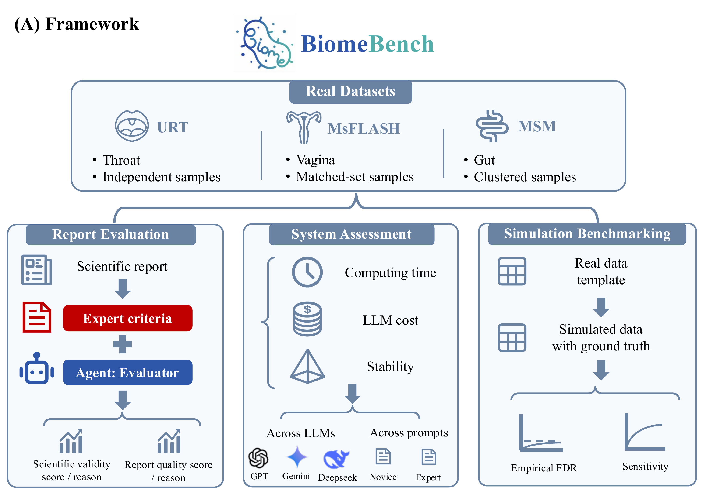
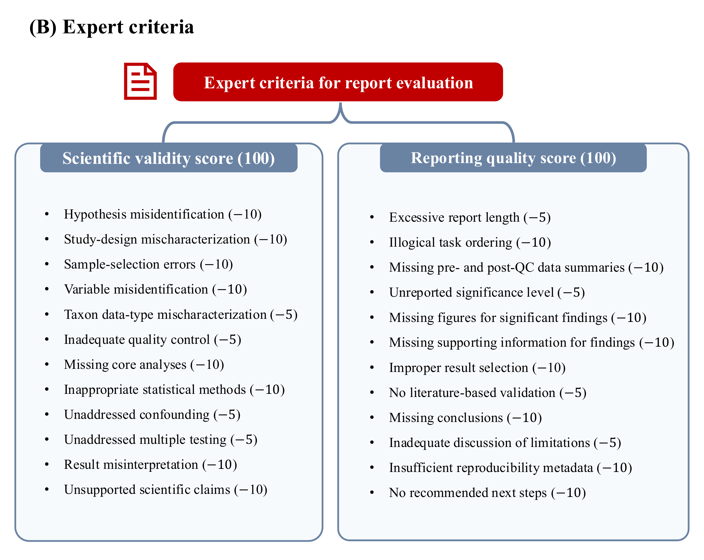
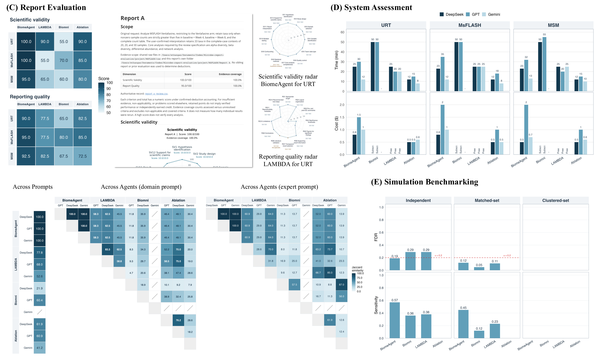

# BiomeBench

**A benchmarking framework for evaluating microbiome analysis agents.**

- Compare independent, matched-set, and clustered microbiome analysis workflows.
- **Evaluator** reviews scientific decisions, evidence, and reports.

## Contents

- [Evaluation framework](#evaluation-framework)
- [Evaluator Agent](#evaluator-agent)
- [Public benchmark data](#public-benchmark-data)
- [Benchmark results](#benchmark-results)
- [Skill access](#skill-access)
- [BiomeAgent](#biomeagent)

## Evaluation framework

- **Report evaluation:** scientific validity and reporting quality, with evidence for each deduction.
- **System assessment:** discovery-set agreement across prompts and models, elapsed time, and recorded LLM charges.
- **Simulation benchmarking:** empirical false discovery rate (FDR) and sensitivity against known signal taxa.

*Figure 2A. Benchmark framework.*

## Evaluator Agent

- **Inputs:** the request, one report, and supporting data, code, tables, and logs.
- **Full benchmark scope:** alpha diversity, beta diversity, differential abundance, and network analysis.
- **Outputs:** authoritative scoring CSV (24 criteria plus two totals), English review, and two radar charts.

**Fairness rules**

- **Independent reviews:** finalize each assessment before consulting other submissions or reviews; never rescore to create rankings.
- **Shared rubric:** apply identical criteria, deduction rules, and task requirements.
- **Evidence over identity:** ignore agent identity, method complexity, report length alone, and discovery counts.
- **Valid alternatives:** judge question–data–design compatibility without requiring BiomeAgent's tools or unrequested thresholds.
- **Traceable deductions:** identify evidence, affected conclusions, and corrections; deduct each problem once.
- **Explicit uncertainty:** distinguish confirmed errors from missing evidence, inapplicable criteria, and issues accounted for elsewhere.

**Scoring**

- Scientific validity and reporting quality each have **12 criteria and 100 points**; there is no combined score or automatic acceptance label.
- Confirmed material scientific errors receive full-weight deductions; reporting deficiencies receive half- or full-weight deductions according to impact.
- Totals equal 100 minus confirmed deductions, without applicability rescaling. Retained points do not establish verification; **evidence coverage** is reported separately.

*Figure 2B. Criteria and deduction weights for the two scoring dimensions.*

### URT evaluation examples

- Two agents analyzed smoking-associated throat microbiome variation, adjusted for sex, excluding recorded antibiotic use.
- Evaluator independently reviewed each submission using its artifacts, shared data, and clarifications; other submissions and prior reviews were excluded.

|                       Evaluation                       | Scientific validity / 100 | Reporting quality / 100 |
| :----------------------------------------------------: | :-----------------------: | :---------------------: |
| [Report A evaluation](examples/report_a_evaluation.md) |           100.0           |          90.0           |
| [Report B evaluation](examples/report_b_evaluation.md) |           90.0            |          77.5           |

- **Scoring records:** [Report A CSV](examples/report_a_review.csv) · [Report B CSV](examples/report_b_review.csv). Reviews include radar charts and itemized findings.
- **Scope:** artifact inspection and targeted recalculation, without a complete clean-environment rerun. Visible source identifiers preclude full anonymity.
- **Interpretation:** Report A's 100.0 reflects no confirmed scientific deduction; **91.7% evidence coverage** leaves some criteria unverified.

## Public benchmark data

### Real data

| Dataset | Design | Input files | Benchmark task |
| --- | --- | --- | --- |
| **URT [1]** | Independent | [Abundance](real%20data/URT/throat_otu_table_full.csv) · [Metadata](real%20data/URT/throat_metadata.csv) | Smoking associations; adjust for sex/gender as specified; exclude recorded antibiotic use. |
| **MsFLASH [2]** | Matched-set | [Bacterial measurements](real%20data/MsFLASH/bacteria_11feb13.txt) · [Metadata](real%20data/MsFLASH/flash03study_11feb13.txt) | Venlafaxine arm; baseline–week 4 and baseline–week 8 comparisons; apply specified prevalence requirements jointly across both pairs and the complete table. |
| **MSM [3]** | Clustered | [Genus abundance](real%20data/MSM/silva_genus_level_add.csv) · [Metadata](real%20data/MSM/metadata.csv) | Group associations without covariate adjustment; account for repeated observations within participants. |

[1] **URT:** Charlson ES, Chen J, Custers-Allen R, et al. (2010). [Disordered microbial communities in the upper respiratory tract of cigarette smokers](https://doi.org/10.1371/journal.pone.0015216). *PLoS ONE*, 5(12):e15216.

[2] **MsFLASH:** Zhu Z, Satten GA, Mitchell C, Hu Y-J (2021). [Constraining PERMANOVA and LDM to within-set comparisons by projection improves the efficiency of analyses of matched sets of microbiome data](https://doi.org/10.1186/s40168-021-01034-9). *Microbiome*, 9:133.

[3] **MSM:** Van Doren VE, Ackerley CG, Arthur RA, et al. (2024). [Rectal mucosal inflammation, microbiome, and wound healing in men who have sex with men who engage in receptive anal intercourse](https://doi.org/10.1038/s41598-024-80074-1). *Scientific Reports*, 14:31598.

### Simulated data with ground truth

- Directories: `simulated data/Independent samples/`, `Matched-set samples/`, and `Clustered samples/`.
- Data and ground-truth annotations are added separately.
- Known signal labels support empirical FDR and sensitivity assessment.

## Benchmark results

*Figure 2, combined results. Report scores, execution resources, discovery agreement, and simulations. Click figures for full resolution.*

- Discovery-set agreement measures consistency, not correctness or reproducibility across repeated runs.
- Simulations use five replicates, 20 signal taxa, and nominal FDR 0.20; five replicates cannot establish general FDR control. Blank positions indicate unavailable results, not zeros.
- Model configurations and availability differ across systems; free/subscription labels are payment categories, not comparable total economic costs.

## Skill access

- Public materials include the benchmark framework, evaluation criteria, example evaluations, and real-data inputs.
- The **full BiomeBench Evaluator skill package is not included in this public repository**. Execution requires a separately configured agent runtime.
- BiomeBench is under active development; installation, licensing, and formal citation details will accompany a future release.

## BiomeAgent

- [**BiomeAgent**](https://github.com/yijuanhu/BiomeAgent): a specialist multi-agent system for end-to-end microbiome data analysis.
