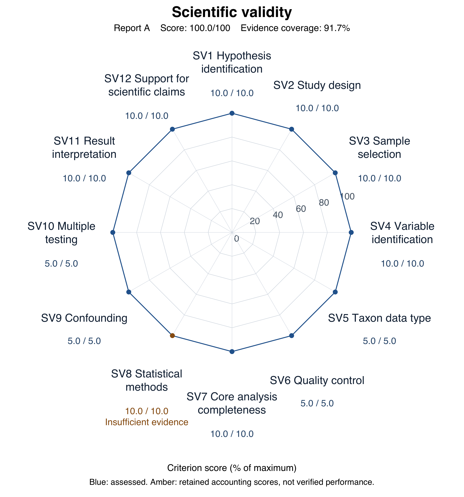
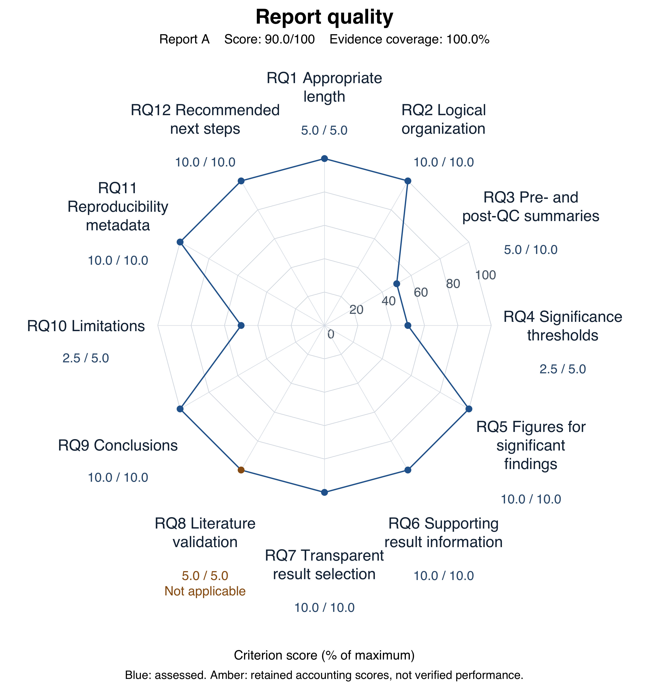

# URT - Report A evaluation

Review date: 2026-09-16. Rubric: current AGENTS.md.

## Scope

Original request: analyze throat data with smoking as the treatment, sex as the covariate, and exclude antibiotic-use TRUE samples. The project rubric additionally requires alpha diversity, beta diversity, differential abundance and network analysis. This review used only the target report folder, shared raw data, and user-supplied clarifications. Prior review files and sibling reports were not used as evidence. Verification included code/output inspection and targeted recalculation, not a complete clean-environment rerun.

Source locators are relative to Report A/ unless they begin with raw data/ or explicitly name the report. Original author paths are retained where quoted.

## Two independent scores

- `scientific_validity_score`: 100.0/100. Evidence coverage: 91.7%.
- `report_quality_score`: 90.0/100. Evidence coverage: 100%.

Every criterion has a numeric accounting score. For insufficient evidence, non-applicability and issues scored elsewhere, points are retained only because no separate confirmed deduction applies; they are not verified validity, applicability or independently earned credit. Totals reflect confirmed deductions only, not certification of every analysis. Coverage is metadata, not a third score.

[Open full-resolution scientific chart](report_a_scientific_radar.png)

[Open full-resolution quality chart](report_a_quality_radar.png)

At the user's request, all 12 axes display numeric scores and plotted points connected into a complete polygon. Blue points denote assessed scores; amber points denote retained accounting scores with explicit evidence-state annotations. Connecting these points does not convert insufficient evidence, non-applicability or issues scored elsewhere into verified performance. Criterion scores and totals are unchanged.

## Principal independent deductions

### RQ3 Pre- and post-QC summaries (-5.0)

Four localized QC-card values are incorrect. Raw 60x856 median is 1494, not 1511; sparsity is 89.421729%, not 88.0%. Filtered 57x226 median is 1404, not 1410; sparsity is 68.653936%, not 67.5%. Correct underlying matrices remain available. These form one summary-reporting defect, not four deductions.

Evidence: Main_microbiome_analysis_report.html: Dataset summary and QC cards; processed/abundance_table.csv; processed/filtered_abundance_table.csv; shared raw matrix

Impact: Descriptive depth and sparsity summaries.

Minimum correction: Generate the four cards directly from the specified stage-specific matrices, stating each denominator.

### RQ4 Significance thresholds (-2.5)

Feature/network FDR thresholds are explicit, but nominal decision alpha for diversity and global tests is not clearly stated.

Evidence: Main_microbiome_analysis_report.html: Diversity analysis, FDR reporting policy and Appendix; results/model_specifications.md

Impact: Decision-policy transparency for community/diversity tests.

Minimum correction: State nominal alpha for these tests separately from feature and network FDR thresholds.

### RQ10 Limitations (-2.5)

Residual confounding, sparsity, sample size and unavailable taxonomy are discussed, but absence of severe dispersion artifacts is listed as an assumption without an explicit unresolved limitation or diagnostic. Group-size dependence of network edge counts also needs clearer treatment.

Evidence: Main_microbiome_analysis_report.html: Robustness and limitations, Appendix Design audit and 31-versus-26 network summary

Impact: Robustness of beta and network interpretation.

Minimum correction: Explicitly describe unverified dispersion and sample-size-dependent network stability, with sensitivity analyses where feasible.

See the [authoritative scoring CSV](report_a_review.csv) for all 24 criteria and any additional deductions.

## Unresolved evidence

- SV8: Alpha residualizes diversity on sex and then applies ordinary Kruskal-Wallis testing; calibration for the conditional question is not established. Recalculated residual-rank p-values are 0.547886 and 0.395797; joint-model sensitivity p-values are 0.301294 and 0.265451, still non-significant. Non-equivalence alone does not confirm a materially false conclusion. Beta-dispersion robustness is also undocumented. Points are retained solely under confirmed-deduction accounting; this is not verified validity, applicability, or independently earned credit. Evidence: results/reproducibility/referenceRcode/scripts/analysis/alpha_diversity_reference.R: lines 29-80; results/model_specifications.md; processed/filtered_metadata.csv; main report Appendix assumptions Required: Provide a justified covariate-adjusted alpha test with calibration/diagnostics and beta-dispersion sensitivity results.

## Evidence-supported strengths and clarifications

- SV1: The question is smoking-associated throat microbiome variation after antibiotic exclusion, with sex adjustment. Evidence: Main_microbiome_analysis_report.html: Research question; results/analysis_parameters.json: primary_estimand
- SV2: The independent cross-sectional analytical unit agrees with 60 distinct PatientID values in the shared metadata. Evidence: raw data/throat_metadata.csv: PatientID; results/study_design_summary.md
- SV3: The three TRUE samples ESC_1.22_OPL, ESC_1.36_OPL and ESC_1.48_OPL are excluded. The retained matrix contains 57 samples, with 31 NonSmoker and 26 Smoker; its counts match the corresponding shared raw cells. Evidence: raw data/throat_metadata.csv: AntibioticUse; processed/filtered_metadata.csv; processed/filtered_abundance_table.csv; results/qc/qc_summary.json
- SV7: All four core categories have reported output: alpha, beta, DA and within-smoking-group networks. Evidence: results/analysis_method_status.csv; results/diversity_analysis/; results/differential_abundance/; results/network_analysis/testnet/*_summary.csv
- SV10: Recounted discoveries at q<=0.20/0.10/0.05 match the report: LDM 22/9/1, LDM-PA 19/7/0, LOCOM2 23/7/4. Network primary q is 0.10. Adjusted feature values, not nominal p-values alone, define discoveries. Evidence: results/differential_abundance/ldm/ldm_feature_results.csv; ldm_pa/ldm_pa_feature_results.csv; locom2/locom2_Wald_feature_results.csv; main report FDR reporting policy
- SV11: Directions, discovery counts and cautious null-result interpretations agree with the supplied tables. The user explicitly confirmed the effect-scale interpretation in this review context; it is accepted as a user-confirmed premise, not presented as a newly independently verified derivation. Evidence: Main_microbiome_analysis_report.html: DA tables and Conclusions; supplied feature CSVs; user clarification that A's effect-size scale interpretation was checked and is correct
- RQ7: Null alpha findings, multiple DA methods, explicit feature-selection rules and unadjusted sensitivity results are disclosed with complete tables. Evidence: Main_microbiome_analysis_report.html: Community-level interpretation, Wilcoxon warning and cross-method rank rule; results/analysis_method_status.csv
- RQ11: Reference helpers, stage scripts, formulas, versions and seeds are supplied. The user confirmed that the reference code is sufficient for reproducibility; no missing-code or archive-portability deduction is imposed. This is not a claim of a new clean-environment rerun. Evidence: results/reproducibility/referenceRcode/scripts/analysis/; code/03_analysis_annotation.R; reports/reproducibility_summary.md; results/analysis_parameters.json; TestNet summaries: seeds 123 and 124; user reproducibility clarification

## Prioritized improvements

- RQ3: Generate the four cards directly from the specified stage-specific matrices, stating each denominator.
- RQ4: State nominal alpha for these tests separately from feature and network FDR thresholds.
- RQ10: Explicitly describe unverified dispersion and sample-size-dependent network stability, with sensitivity analyses where feasible.
- SV8: Provide a justified covariate-adjusted alpha test with calibration/diagnostics and beta-dispersion sensitivity results.
