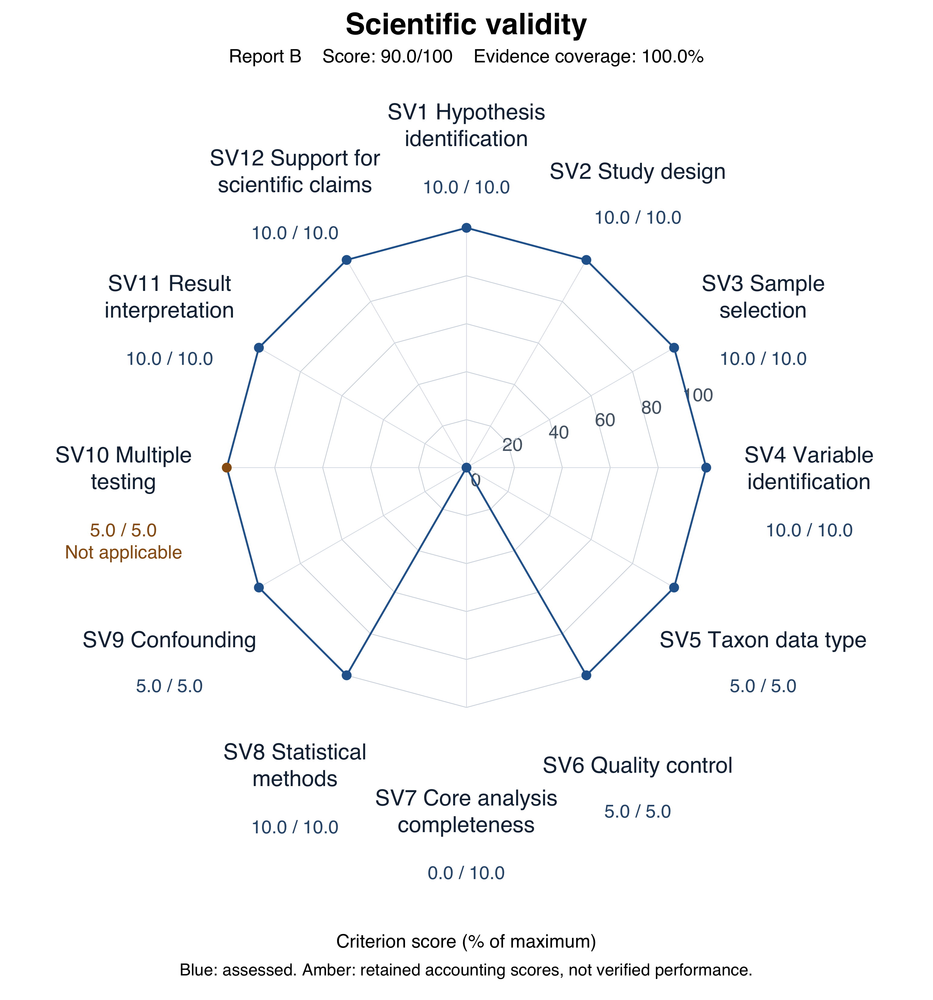
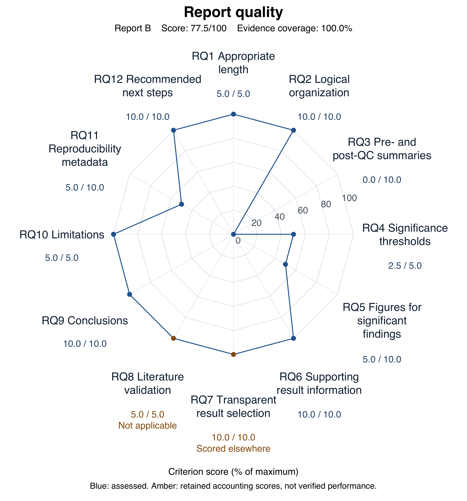

# URT - Report B evaluation

Review date: 2026-09-16. Rubric: current AGENTS.md.

## Scope

Original request: analyze throat data with smoking as the treatment, sex as the covariate, and exclude antibiotic-use TRUE samples. The project rubric additionally requires alpha diversity, beta diversity, differential abundance and network analysis. This review used only the target report folder, shared raw data, and user-supplied clarifications. Prior review files and sibling reports were not used as evidence. Verification included code/output inspection and targeted recalculation, not a complete clean-environment rerun.

Source locators are relative to Report B/ unless they begin with raw data/ or explicitly name the report. Original author paths are retained where quoted.

## Two independent scores

- `scientific_validity_score`: 90.0/100. Evidence coverage: 100%.
- `report_quality_score`: 77.5/100. Evidence coverage: 100%.

Every criterion has a numeric accounting score. For insufficient evidence, non-applicability and issues scored elsewhere, points are retained only because no separate confirmed deduction applies; they are not verified validity, applicability or independently earned credit. Totals reflect confirmed deductions only, not certification of every analysis. Coverage is metadata, not a third score.

[Open full-resolution scientific chart](report_b_scientific_radar.png)

[Open full-resolution quality chart](report_b_quality_radar.png)

At the user's request, all 12 axes display numeric scores and plotted points connected into a complete polygon. Blue points denote assessed scores; amber points denote retained accounting scores with explicit evidence-state annotations. Connecting these points does not convert insufficient evidence, non-applicability or issues scored elsewhere into verified performance. Criterion scores and totals are unchanged.

## Principal independent deductions

### SV7 Core analysis completeness (-10.0)

Alpha and beta diversity are completed, but differential abundance is deferred to future work and no network analysis is supplied. These omissions incur one deduction in total.

Evidence: Report B PDF complete pp.1-5, especially p.5 next steps; Report B directory contains only this PDF

Impact: The mandatory core analysis set is incomplete.

Minimum correction: Complete differential abundance with sex adjustment and appropriate multiplicity control, and a defensible exploratory network analysis.

### RQ3 Pre- and post-QC summaries (-10.0)

Sample flow and sex balance are reported, but feature counts, the tab5 filtering definition, sequencing-depth summaries and sparsity before and after QC are absent.

Evidence: Report B PDF p.2 data description and complete pp.1-5

Impact: Readers cannot assess the feature-level and sequencing-depth consequences of preprocessing.

Minimum correction: Add pre/post feature counts, define the prevalence filter, and summarize depth and sparsity for the analyzed population.

### RQ5 Figures for significant findings (-5.0)

The figure heading states that sex has been controlled, while the panels show descriptive PCoA and raw richness. Nearby text clarifies descriptive use, limiting this to a localized labeling ambiguity.

Evidence: Report B PDF p.3 Figure 1 heading, panels and surrounding paragraph

Impact: The visual may be mistaken for a covariate-adjusted display.

Minimum correction: Label the panels as unadjusted descriptive displays and reserve sex-adjusted wording for the formal models.

### RQ11 Reproducibility metadata (-5.0)

The appendix supplies the central filter and model and text supplies alpha formulas, but the advertised accompanying script is absent; versions and random seed are not supplied. The main estimates can nevertheless be reconstructed.

Evidence: Report B PDF pp.4-5 and Report B directory inventory

Impact: Exact stochastic p-values and the complete execution environment cannot be reproduced from the supplied artifacts.

Minimum correction: Supply the referenced script with software/package versions and random seeds.

### RQ4 Significance thresholds (-2.5)

The nominal significance threshold used for significant and non-significant labels is not explicitly specified.

Evidence: Report B PDF pp.3-5

Impact: The decision threshold is implicit although the reported p-values remain interpretable.

Minimum correction: State the nominal alpha used for primary and secondary tests.

See the [authoritative scoring CSV](report_b_review.csv) for all 24 criteria and any additional deductions.

## Unresolved evidence

No unresolved criterion remains in this evidence assessment; this does not imply that every computation was independently rerun.

## Evidence-supported strengths and clarifications

- SV1: Smoking is the exposure and sex the covariate; the eligible throat population and association estimand match the request. Evidence: Report B/2026-07-16_LAMBDA_Report_Throat.pdf pp.1-2,5
- SV2: Independent participant-level analysis is consistent with 60 unique participant identifiers in shared metadata. Evidence: Shared raw metadata PatientID; Report B PDF pp.2,5
- SV3: Excluding three antibiotic users produces 57 samples; group and sex counts match shared data. Evidence: Report B PDF p.2 Table 1 and p.5 keep expression; shared metadata
- SV11: Numerical estimates agree with reconstructed results; modest R2, insufficient evidence for alpha change, and the limited role of dispersion testing are appropriately distinguished. Evidence: Report B PDF pp.3-4 Table 2 and sections 3.1-3.2; targeted raw-data reconstruction

## Prioritized improvements

- SV7: Complete differential abundance with sex adjustment and appropriate multiplicity control, and a defensible exploratory network analysis.
- RQ3: Add pre/post feature counts, define the prevalence filter, and summarize depth and sparsity for the analyzed population.
- RQ5: Label the panels as unadjusted descriptive displays and reserve sex-adjusted wording for the formal models.
- RQ11: Supply the referenced script with software/package versions and random seeds.
- RQ4: State the nominal alpha used for primary and secondary tests.
